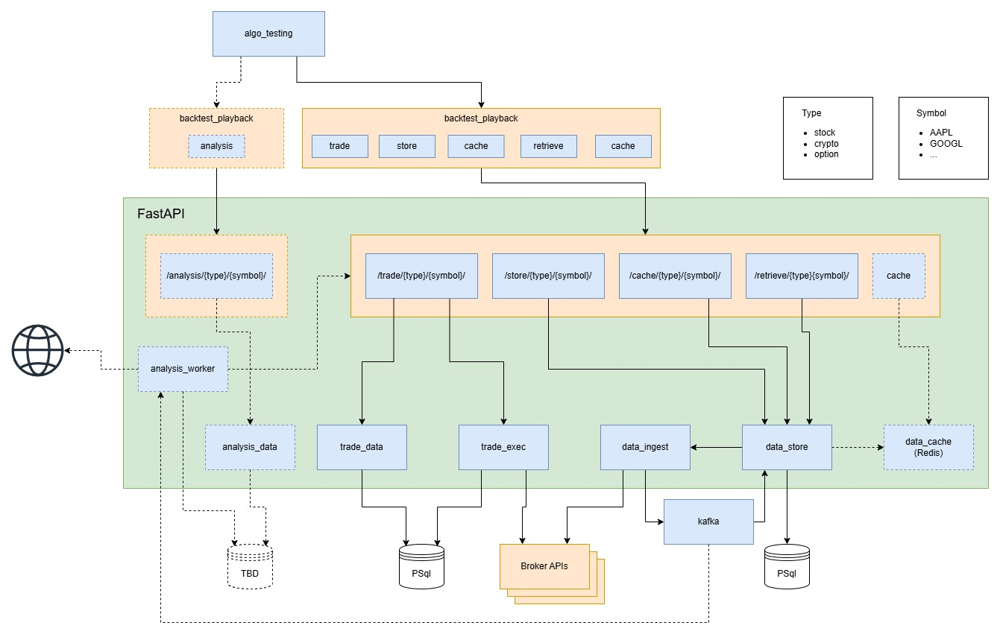

# TraderJoe
framework for testing trading algos

## Design


**Direction, not built:** request scheduling moves to ingest, with the store keeping the request log
and each request's state (decided by the owner on 2026-10-12, recorded on decision record `tj-pd41mt`,
whose end-state design is still being written up). Today there is no
request log, queue or scheduler: a request is a `POST /store`, and the store only records each fetch
it drives as a run.

## Getting Started
Take a look at the `Makefile` for all the major commands. Every compose target names the stack it
means — `dev-*` builds and runs the development images (live reload, debug logging, the debugger,
source bind-mounted from this checkout, and pgAdmin), `prod-*` the production ones. Never mix a
`dev-` build with a `prod-` launch; they produce different images.

```
# Development
make dev-build
make dev-launch     # foreground, so you see the reload output; Ctrl-C stops it
make dev-up         # or detached: stops the dev stack first, then starts it and waits for healthy
make dev-logs       # follow the app services' logs (Ctrl-C stops the follow, not the stack)

# Production
make prod-build
make prod-launch    # detached, and blocks until every service reports healthy
make migrate        # see below — nothing else creates the schema
make prod-logs      # follow the service logs
```

Both stacks include the web UI (see [The web UI](#the-web-ui)). The builds need the pinned Node and
the web dependencies first: `make node-install` and `make web-install`.

**On a production host, never run a bare `docker compose up`.** With no `-f`, compose also loads
`docker-compose.override.yaml` next to `docker-compose.yaml`, and that file is the development one: it
starts postgres with the dev marker (`cluster_name=dev`, see
[Seeding refuses a database without a marker](#seeding-refuses-a-database-without-a-marker)), labels the
store `dev`, publishes the dev ports on loopback and joins the dev network. Start prod only through its
targets (`make prod-build`, `make prod-launch`, `make prod-down`), which name the production files
explicitly and never load the override.

**The dev web container's write secret.** The dev web container needs `INSTANCE_WRITE_SECRET` to make
the UI's two writes. The Makefile resolves it with `tools/dev_instance_secret.sh`, in the recipe's own
shell and never in `make` itself, so `make -n` shows the call and never the value: the shell's
`INSTANCE_WRITE_SECRET` if it is set, else the last `INSTANCE_WRITE_SECRET=` line of the root `.env`,
else the placeholder `unused`. An empty `.env` therefore still launches (`make dev-launch` works),
reads work, and data_store refuses every write; set the secret (see
[Writing data](#writing-data-the-instance-secret)) to make the UI's writes work in dev.

`make dev-deps`, `make dev-launch`, `make dev-up` and `make dev-tools` create the shared dev network
first (see below); `make dev-network` does it on its own. The network is never removed by any target.

**`make dev-up` is designed to end an attached `make dev-launch`.** It brings the dev project down
before it starts it, so there is only ever one instance, and a `dev-launch` still running in a terminal
would be left watching containers that `dev-up` replaced. That the session ends has not been measured on
a host yet. Use `dev-up` when the terminal must come back, and
`dev-launch` when you want the reload output. The down removes containers and networks (pgAdmin
included) and never a volume: the database is a host directory (`DATA_DIR/postgres`) and survives.

**Generated code must be current before a build.** `make dev-build` regenerates the Python and
TypeScript message code (`make proto gen-proto-ts`) first. The agent-stack MCP cannot run the
generators, so its `build` and `up` refuse unless each generated tree is present and was generated from
the current protos. That is decided by content, not by file times: `make proto` and `make gen-proto-ts`
write a stamp beside the tree (`gen/proto/python.digest`, `gen/proto/ts.digest`), and the MCP compares it
with a digest of the current `.proto` files (for `ts`, also `buf.yaml` and `web/buf.gen.yaml`) computed by
its own baked copy of `tools/proto_digest.sh`. Touching a file changes nothing; identical content passes,
and any edit, add, remove or rename of an input refuses. Run `make proto gen-proto-ts` on the host, then
call them again. (`test_build` checks `gen/proto/python` only, because test mode has no web service; its
refusals say `make proto`.)

**Two compose projects.** Dev and test run as one explicit compose project, `trader_joe_dev` (the
Makefile's `DEV_PROJECT`, a fixed `override` constant that neither the command line nor the environment
can change, passed as `-p` on every dev and test command), so only one of those two is up at
a time, and launching one takes down the other. Prod keeps compose's default project name, the
checkout directory's (`trader_joe` for a checkout of that name), and its launch is unchanged: no `-p`.
No dev or test target addresses prod's project, so none can stop or replace a production stack.

| Mode | Started by | Images | Data directory | Broker |
|---|---|---|---|---|
| Dev | `make dev-up` or `make dev-launch` | `:dev`, from `make dev-build` | your `DATA_DIR` | the real one |
| Test | `make system-launch` | `:test`, from `make test-build` | `./volume_data/test`, fixed | the fake (`FakeRead`) |
| Prod | `make prod-launch` | `:latest`, from `make prod-build` | your `DATA_DIR` | the real one |

`DATA_DIR` is the root env file's value (`.env.default` sets `./volumes/trader_joe/`; unset, compose uses
`./volume_data`), and the MCP never overrides it for dev.

`make dev-up` and `make system-launch` take the `trader_joe_dev` project down first, whatever mode it
holds (`dev-launch`, `dev-deps` and `dev-tools` only when a test-mode container is up; they never take
down a running dev stack). Your dev data is never in `./volume_data/test`, so running the system suite never
writes to it. `make prod-launch` is unchanged and takes no other mode down. Test mode never builds or runs
`:latest`, which may be a real deployment's image: `make system-launch` refuses until
`make test-build` has made the two `:test` images.

**Prod and dev on one host collide, and the second launch fails.** The two projects are separate by name
only, and the compose files fix two names host-wide. Postgres has a fixed container name
(`container_name: ${DATABASE_NAME}`), which every stack uses, prod and test included. The web container
publishes `127.0.0.1:${WEB_PORT:-8088}`, which prod and dev both do. Docker refuses the second container on
either name, so whichever stack launches second fails and changes nothing of the first. That is intended:
no target tears down the other project to make room. (Dev's other published ports are its own, and prod
does not publish them. pgAdmin, with its fixed name, runs only in dev.) Stop one before starting the other, with
`make prod-down` for prod or `make dev-down` for dev and test; each reaches its own project only.

**One-time step on an existing dev machine.** Dev and test used to run in the default project. A stack
started under the old project name must be stopped by name before the first `make dev-up` of this version,
because its containers still hold postgres's fixed name and the web port. From the repository root:

```
docker compose -p trader_joe down --remove-orphans
```

This was run on the owner's stack and removed its web, data_store, db and data_ingest containers and its
four `trader_joe` networks. Then:

1. `make dev-up`, which starts the stack as `trader_joe_dev`. The first one after pulling this version
   recreates the dev containers, because postgres now starts with the dev marker (see
   [Seeding refuses a database without a marker](#seeding-refuses-a-database-without-a-marker)); the data folder
   is a host directory and survives.
2. `make agent-mcp-rebuild`, then reconnect the MCP in your client, because the MCP now addresses
   `trader_joe_dev` only (see [The agent-stack MCP](#the-agent-stack-mcp)).

Your data folders (`DATA_DIR` and `./volume_data/test`) are host directories and are untouched. A prod
host needs nothing: its project and launch did not change.

### Seeding refuses a database without a marker

The dev showcase seed (`tools/dev_datasets`, see its [README](tools/dev_datasets/README.md)) empties and
refills the store's tables, so it checks twice that it is talking to a dev or test stack. The store must
report `deploymentLabel` `dev` or `test`, and the database itself must carry the same marker: postgres is
started with `cluster_name=dev` by `docker-compose.override.yaml` (dev) or `cluster_name=test` by
`docker-compose.fake.yaml` (test mode), as a server option on its command line. Prod never sets it. The tool
reads it from `pg_settings` on the connection it is about to write through, and proceeds only when the
setting's source is `command line` and its value is `dev` or `test` and equals the store's label. A value a
client sets itself, or one set with `ALTER ROLE` or `ALTER DATABASE`, has another source and is refused.

A refusal changes nothing, exits 1 and reads like this (the value and source shown are what it found,
`none` when there was no row):

```
refused: the database is not this dev or test stack (cluster_name 'none' from source 'none', the store says 'dev'); nothing was changed
```

The usual cause is a dev or test stack started before the marker existed. The first `make dev-up` (or
`make system-launch`) after pulling this version recreates the postgres container with it; the data folder
is a host directory and survives.

**Trying the reaper on a dev stack.** The expiry reaper is dry-run by default (see
[Retention, usage and the scheduler](#retention-usage-and-the-scheduler)). `REAPER_DELETES_ENABLED` and
`REAPER_INTERVAL_SECONDS` must **never be written to a committed file or to the data_store settings file**:
that file (`server/data/store/.env` unless `STORE_ENV_FILE` points elsewhere) is read by data_store in every
stack of this checkout, dev and prod alike, so a flag there turns deletion on wherever it is read. To try
it on dev only, put the two variables under `data_store`'s `environment:` in a small compose file
**outside the repository**, and start data_store with that file added after the dev set (the dev set is
the Makefile's `DEV_COMPOSE`; this spelling follows it, and on the owner's dev stack it deleted the seed's
past-expiry row with cause `REAPER`):

```
INSTANCE_WRITE_SECRET="$(sh tools/dev_instance_secret.sh)" docker compose -p trader_joe_dev \
  -f docker-compose.yaml -f docker-compose.override.yaml -f docker-compose.web.yaml \
  -f docker-compose.web.dev.yaml -f /path/outside/the/repo/reaper-trial.yaml up -d data_store
```

`make dev-up` ends the trial: it takes the project down and starts it again from the repository's own
files, where the reaper is dry-run again.

## Networks: prod publishes one loopback port

The two stacks are wired differently on purpose (decision record `tj-q9ae5u`, addendum 1).

**Prod** puts every service on named networks and publishes **no host port**, with one deliberate
exception: the web container's single port, on loopback only (see [The web UI](#the-web-ui)).

| Network | Kind | Members |
|---|---|---|
| `store_db` | internal | postgres, data_store |
| `ingest_store` | internal | data_store and data_ingest |
| `store_api` | internal, fixed name `trader_joe_store_api` (`STORE_API_NETWORK`) | data_store, client containers and the web container |
| `ingest_egress` | ordinary bridge | data_ingest only |
| `web_edge` | ordinary bridge | the web container only, because an internal network cannot publish a port |

An internal network has no gateway, so postgres and data_store have no egress and cannot be
reached from the host or the internet. data_ingest is the one component with internet access, for
the broker API. A client — a strategy container, the SDK, the system-test client — joins
`store_api`, which has a fixed name so another compose project can declare it external, and sees
data_store and nothing else. To look inside a prod stack, use `docker compose exec` or a client
container on `store_api`.

The fixed name is read from `STORE_API_NETWORK`, defaulting to `trader_joe_store_api`; nothing in the
repository sets it. In the same way, every service's env files are read from `ROOT_ENV_FILE`,
`STORE_ENV_FILE` and `INGEST_ENV_FILE`, defaulting to `.env`, `server/data/store/.env` and
`server/data/ingest/.env`; a normal launch never sets them.

**Upgrading from the layout before the monorepo split:** the per-service env files moved with their
directories, from `data/store/` and `data/ingest/` to `server/data/store/` and `server/data/ingest/`.
Compose does not find an untracked file left at the old path, and `make dev-launch` stops on it. Move
each one:

```
mv data/store/.env server/data/store/.env
mv data/ingest/.env server/data/ingest/.env
```

The root `.env` has not moved. Each service directory also carries a `.env.default` to copy from if
you never had a file.

**Dev** adds one external network, `trader_joe_devnet`, created by `make dev-network`. The dev
override attaches every stack service to it and publishes postgres, data_store and data_ingest on
**loopback only** (`127.0.0.1`), for psql, `/docs` and curl from this machine. pgAdmin and the agent
devcontainer join the same network, so a dev session reaches every service by name. A prod launch
never loads the override, so it never attaches devnet. The web container's port is the one published
by both stacks, on loopback in each.

None of this is authentication. Inside the networks, every surface except the write routes (the three
under `/store` and `/internal`, and the two operator writes under `/ui/v1`) answers without credentials.

## The web UI

A browser UI for the dataset catalog (with who has read what, and what is stale or expiring), a
per-dataset detail (coverage and gaps, run history, and the expiry and delete controls), a usage tab
and a viewer (candles, volume and a paged bar table). It updates live: data_store pushes a notification over
a WebSocket whenever a dataset or a collection run changes, and the UI refetches.
Its source is in [`web/`](web/README.md): a Vue 3 single-page app, built once and served as static
files.

| Stack | Launch | What runs |
|---|---|---|
| Dev | `make dev-build`, `make dev-launch` | The Vite dev server with hot reload; edits under `web/src/` appear at once. |
| Prod | `make prod-build`, `make prod-launch` | A Caddy container serving the built app. |

Both are at `http://localhost:8088/`. `WEB_PORT` in the root env file changes the port, and prod and
dev share it, so only one stack runs at a time. The port binds `127.0.0.1` only; reaching it from
another machine is a host decision (a tunnel or an overlay network), not a setting here.

**The proxy.** The browser talks to one origin. Caddy (`deploy/web/Caddyfile`) forwards
`/api/store/ui/v1/*` to data_store with the `/api/store` prefix stripped, so
`/api/store/ui/v1/datasets` becomes `/ui/v1/datasets`. Four rules pass: `GET` and `HEAD` under that
prefix, `PATCH` on one dataset's `/expiry`, `PATCH` on one dataset's `/collecting`, and `DELETE` on one dataset. Nothing else does: not another
method, and not `/store/*`, `/internal/*` or `/docs`, and there is no route to data_ingest. The
instance secret is added to the proxied request inside the container, so the browser never holds it and
can write only through those three write routes. The dev server (`vite.config.ts`) mirrors the same four rules
on the decoded, cleaned path (an escape, `//`, `./` or `..` is a 400) and adds the secret from its own
process environment, so dev fails where prod does.
The live socket, `GET /api/store/ui/v1/events`, is an upgraded `GET` and passes the same filter.
data_store must run **one worker** for it to be correct, because the hub that fans events out is in
the process's memory: `docker-compose.yaml` pins `SERVICE_WORKERS=1` for it, and the env file cannot
change that. `EVENTS_CLIENT_QUEUE_SIZE` (default 256) is how many events a slow client may hold
before it is dropped and reconnects.
There is no login: access is network-only, so run it only where the network is trusted. Because the
UI can now delete datasets, that is not only a convenience: put a login in front of it before the
stack trades with real money.

**The licence key.** The UI uses PrimeVue 5 under the PrimeUI Community licence, which needs a key.
Put it in the root env file as `VITE_PRIMEUI_LICENSE_KEY`; `.env.default` carries the name empty, and
the key is never committed. Prod bakes it into the JavaScript bundle at `make prod-build`, which the
licence allows, so **never push an image built with a key to a public registry**. Without a key the
app still builds and shows a licence notice.

**Generated TypeScript** for the UI's messages is written to `gen/proto/ts/` by `make gen-proto-ts`
and is never committed (`gen/` is gitignored). The build targets run it first. The routes the UI reads
are in [`docs/API.md`](docs/API.md).

## Dependencies and the lockfile

`uv.lock` is **frozen by default**. The `Makefile` exports `UV_FROZEN=1`, so every `uv` it runs
installs the lock exactly as committed and never re-resolves it — editing `pyproject.toml` does not
change the lock, and a new dependency does not reach the virtualenv, until you re-lock on purpose:

```
make lock    # the one deliberate re-lock; commit uv.lock with the pyproject.toml change
```

Two guards sit around that. `pyproject.toml` sets an install cooldown (`exclude-newer = "7 days"`),
so a resolve never picks a release younger than a week. And every target that can write the lock
refuses to run under a `uv` older than the version pinned in the `Makefile`, because an older `uv`
can re-resolve and overwrite the lock — reverting pinned versions and the cooldown — while every
command still exits 0.

Base images are pinned the same way. Every external image the `Dockerfile`,
`tools/agent_mcp/Dockerfile` and the agent-stack MCP's socket proxy build from is pinned as
`tag@sha256:<digest>`, so a tag that moves upstream never changes what builds. Bumping one means
changing the digest on purpose. The agent-stack MCP keeps its own list of the root `Dockerfile`'s
references (`BASE_IMAGES` in `tools/agent_mcp/stack.py`) and makes sure they are present before
every build, so the two must name the same references; a test checks that they do. The postgres
image in `docker-compose.yaml` is pinned by tag only.

## Writing data: the instance secret

Every dataset **write** route needs a shared secret; reads need nothing. That is the three under
`/store` and `/internal` and the two operator writes the UI makes. Set it once per deployment:

```
echo "INSTANCE_WRITE_SECRET=$(openssl rand -hex 32)" >> .env
```

and send it on each write as the `X-Instance-Secret` header. The check fails closed: while the
variable is unset or empty, **every write is rejected** with a 401, and the service logs why.

Be clear about what this is. **The secret authenticates the deployment, not the caller.** Each
dataset records an `owner` — the principal the caller declares on the request — and a write naming the
wrong owner is refused. But with one key there is effectively one principal: anyone holding the key
can declare any owner. The owner check protects against mistakes, not against a holder of the key, and
it does nothing for the services' other surfaces, which answer anyone who can reach them — any
container on the stack's networks, or this machine's loopback in dev. `docs/API.md` has the full
contract.

**Expiry is optional, and it is a deletion date only.** No expiry means the dataset is never deleted by
the reaper. A request that omits `expiry` (or sends `null`) stores none. Before this release an omitted
`expiry` defaulted to one day after the request, so a client that relied on that default now gets a
dataset that never lapses; send an explicit `expiry` to keep the old behaviour. Repeating a request
exactly reuses the stored dataset and sets its expiry **from the new body**, so a repeat POST without an
expiry **clears** a stored one. Setting or clearing an expiry never stops or resumes collection.

**Collecting is a separate intent, `collect`.** A `DAILY` or `STREAM` dataset is a subscription, and
`collect` says whether it is being collected: true (the default when you create one) or false, which
the UI calls Stopped. `POST /store` takes an optional `collect` for subscriptions only (a `STATIC`
request that sends one is a 422). On a repeat request an omitted `collect` **leaves the stored value
alone**, so retrying your original body cannot undo an operator's Stop; only an explicit `collect` changes
it. A `STATIC` dataset has no intent: it counts as collecting only while a run of it is in flight.

The `owner` value is kept out of the text the store renders: request-model reprs, the entry row's
repr, the bound parameters in a SQL error, and the search log line all show `<redacted>`. Two places
still carry it: Postgres's own `DETAIL` text on a constraint violation, and any code that formats the
value itself with `str()` or an f-string. The open read returns `owner` anyway, so this is log
hygiene, not secrecy.

## Retention, usage and the scheduler

data_store does four periodic jobs besides serving requests. All four run inside its one process (see
[The web UI](#the-web-ui) for why that must stay one worker), and all four read the database on every
pass: nothing is queued, so after a restart the next pass is the catch-up.

| Job | What it does | Settings (defaults) |
|---|---|---|
| Expiry reaper | Deletes datasets whose expiry has passed, whether or not they are still collecting, and records each deletion | `REAPER_INTERVAL_SECONDS` (3600), `REAPER_DELETES_ENABLED` (off) |
| Daily refresh | Keeps `DAILY` datasets that are collecting current: after a trading session closes, plus a settle delay, it requests each stale dataset's missing tail | `DAILY_REFRESH_ENABLED`, `DAILY_REFRESH_SETTLE_MINUTES` (30), `DAILY_REFRESH_MAX_PER_PASS` (10), `DAILY_REFRESH_BACKOFF_SECONDS` (30) |
| Usage recorder | Buffers bar reads and writes them in batches | `USAGE_FLUSH_INTERVAL_SECONDS` (5), `USAGE_FLUSH_BATCH_SIZE` (500), `USAGE_BUFFER_MAX` (10000) |
| Usage rollup | Folds per-read rows older than the window into daily summaries | `USAGE_ROLLUP_AFTER_DAYS` (90), `USAGE_ROLLUP_INTERVAL_SECONDS` (3600) |

Set them in the data_store env file. Each is read at start, so a change needs a restart. One
exception: never put `REAPER_DELETES_ENABLED` there on a checkout that runs both dev and prod, because both read that
file (see [Seeding refuses a database without a marker](#seeding-refuses-a-database-without-a-marker)).

**The reaper is dry-run by default, and it stays that way until you read what it would delete.**
`REAPER_DELETES_ENABLED` must be the value `true` to delete anything (any letter case, so `True` and `TRUE`
count, and surrounding whitespace is ignored). Anything else, including unset, `1`, `yes` and `false`, leaves
the reaper in dry-run, and the flag is unset in every committed file. The reason is concrete: before
this release a dataset created without an `expiry` was given one day after the request, so older
`STATIC` datasets made that way are already past expiry, and an enabled pass would delete them. In
dry-run the reaper logs a count and deletes nothing. `GET /ui/v1/reaper/pending` (and the Datasets
page's Expiring Soon view) lists what a pass would delete, and `deletesEnabled` on that page
says whether deletes are on. Enabled, each pending dataset is deleted in its own transaction and
recorded in the append-only `dataset_deletion` table, one row per dataset; a dataset with a fetch in
flight waits for the next pass, and while the audit tables are missing (`make migrate` creates them)
an enabled pass deletes nothing, so a deletion is never unrecorded.

**The operator writes** are `PATCH /ui/v1/datasets/{id}/expiry`, `PATCH /ui/v1/datasets/{id}/collecting` and `DELETE /ui/v1/datasets/{id}`.
They need the instance secret like every write; the web proxy adds it. Acting on a dataset whose owner
is not `operator` needs an explicit override (`{reason, confirmed}`); without it the answer is a 409
`OVERRIDE_REQUIRED` that does not name the owner. Overrides go to an append-only `dataset_override_log`,
and if the audit tables are missing the write is refused with a 503 before anything changes. On a
`DAILY` or `STREAM` dataset, `PATCH .../collecting` with `{collect, override}` stops (`false`, which the
UI labels Stopped) or restarts (`true`) collection and the refresh skips a stopped one; `collect` is required
in the body, and a `STATIC` dataset is refused with a 422. Setting an expiry changes only the deletion date.
The reaper still deletes a stopped dataset once its expiry has passed. A stopped dataset with no expiry stays
until you delete it.
The full contract is in [`docs/API.md`](docs/API.md).

**The daily refresh is an interim scheduler**, kept in the store until ingest has its own. Per trading
calendar it runs after the session close plus `DAILY_REFRESH_SETTLE_MINUTES`, and once at start. Each pass
requests, one dataset at a time and at most `DAILY_REFRESH_MAX_PER_PASS`, only the missing tail of each
`DAILY` dataset that is collecting (`collect` not false) and is behind. A transient failure backs off (starting at
`DAILY_REFRESH_BACKOFF_SECONDS`, doubling, capped at ten minutes), the pass stops after three in a row
or at once on a rate limit, and **nothing is retried automatically**: a dataset that failed waits for
the next session close. A request the vendor refuses permanently is skipped until the next close. The
pass is fair: datasets never attempted go first, then the least recently attempted. A dataset stopped
while its fetch is in flight stays stopped; the answer is dropped. **It is on by default**
(`DAILY_REFRESH_ENABLED=false` turns it off, read at start). That default is accepted for the broker
supported today, which only returns an error when a limit is exceeded. **A cumulative cap must exist
before any broker that penalises exceeding limits is enabled**: today nothing counts vendor usage across
restarts, and the only bounds are the per-pass cap, the one-at-a-time serialisation, the vendor rate
budget and the missing-tail-only request.

**Usage tracking.** Each bar read is recorded as one row against a label the reader sends in the
`X-Client-Id` header: send your owner string. It is a label for usage statistics, never a credential,
and the web UI sends `operator`. Per-read rows are folded into daily summaries after
`USAGE_ROLLUP_AFTER_DAYS`, so staleness stays exact. The UI's Usage tab and the dataset filters are built
on it; a dataset is stale when the selected clients have not read it in 90 days (a fixed threshold in the
UI; the API takes `stale_days`). Recording is buffered and best effort: a failed write is retried, and
the buffer drops its oldest reads past `USAGE_BUFFER_MAX`.

**Known limits** (what bounds each is in
[`server/data/store/CLAUDE.md`](server/data/store/CLAUDE.md#known-limits)): one usage batch can be
counted twice at shutdown; the statistics routes exceed a database parameter limit for a single source of about 16,000
datasets or more; the refresh's "already tried" skip is shared by owners who request the same symbol and
tail; a dataset restarted after a stop during a fetch waits for the next close; the trading calendars end about a year
after a process starts, so restart data_store at least yearly or the daily refresh stops refreshing; the
owner string appears in access log lines for the routes that carry it in the query string
(`DELETE /store/{id}?owner=...`, `GET /store?owner=...`); the agent MCP tooling is capped below `mcp` 2.

## How market data is stored

A **dataset** is one request for data, identified by every field it was requested with: owner,
symbol, asset type, data type, source, granularity, expiry type, update type, and the start and end of
its range. Two requests that differ in any of them are two datasets, and each holds **its own copy**
of its bars — a bar belongs to exactly one dataset and is deleted with it. That makes a dataset's
contents unambiguous and its deletion a cascade, at the cost of duplicate storage when datasets
overlap. Repeating a request exactly reuses the existing dataset; overlapping one of your own datasets
without matching it is refused with the colliding id.

Every range is **half-open**, `[start, end)`: the start is included and the end is excluded. Two
ranges that only touch (one ends where the next starts) do not overlap, a bar stamped exactly at
`end` belongs to the next range, and a declared `end` that is not after `start` is refused with a 422.
A dataset's freshness (healthy, late, failed or retired, where retired means a subscription whose `collect` is false, shown as Stopped) and completeness are not stored: the server
computes them on read, against a trading calendar for the dataset's source.

What *is* stored about collection is a **run**: each store-driven fetch writes one `ingest_run` row,
`RUNNING` while the vendor answers and then `SUCCEEDED`, `EMPTY` (the vendor held no bars) or `FAILED`
with the typed error. A run left `RUNNING` by a process that stopped is marked `FAILED` with reason
`INTERRUPTED` at the next start. Runs outlive their dataset's deletion but are read per dataset, so a
deleted dataset's runs are no longer reachable.

Bars are stored **raw**. There are no split or dividend factors on a bar, and corporate-action
adjustment on read is decided but **not built** — everything returned today is unadjusted.

## Database migrations

Nothing in the stack creates the schema on its own — not the container entrypoint, not the
service at startup. A stack that reports healthy still has an **empty database** until the
migrations are applied.

```
make migrate
```

**Run this after every deploy**, and after any pull that brings new revisions. Migrations are a
deploy step, not part of starting the stack (decision record `tj-x3ig38`). `make migrate` is the
only supported spelling of that step: run it by hand today, and the server deploy script will call
the same target once it exists. This version adds the `collect` column to `store_dataset_entry`, so a
database one revision behind needs it before the store runs.

Start the database first — `make dev-deps` (or `make dev-launch`) on a dev stack, `make prod-deps`
(or `make prod-launch`) on prod — then `make migrate`. The target requires postgres to already be running and exits non-zero with a pointer if it is not. It
will not start the database itself on purpose: bringing the stack `up` recreates a container whose
config has changed, and a migration must never restart the database it is migrating. For the same
reason it is not wired into any launch target: a rollback re-runs `compose up`, and a migration
hanging off that would re-apply from whichever revision directory happened to be checked out.

`make migrate` applies the revisions to the **running** stack, through that stack's own `data_store`
service definition, in a one-off container. It first finds the project: it looks for a running postgres in
`trader_joe_dev` (dev and test), then in the default project (prod). Both running is refused, because
nothing says which database is meant; stop one and re-run. If the `COMPOSE_PROJECT_NAME` environment
variable is set to `trader_joe_dev`, both lookups reach the same postgres container, which counts as one
project, the dev one. It then reads which stack is running from that postgres container:

| The running postgres was started with | `make migrate` uses | Image it runs |
|---|---|---|
| `docker-compose.override.yaml` (the dev stack) | the dev definition, base plus override | `:dev`, from `make dev-build` |
| `docker-compose.fake.yaml` and no override (test mode) | the test definition, base plus fake | `:test`, from `make test-build` |
| anything else, in the default project | the production definition, `docker-compose.yaml` alone | `:latest`, from `make prod-build` |

So `make dev-build`, `make dev-launch`, `make migrate` works with no production build. It prints one
line to stderr saying which definition it chose and why, and in which project. What it cannot tell
unambiguously — no compose label, more than one postgres or `data_store` container, a dev (or test)
postgres beside a `data_store` of another mode — depends on the project. In the default (prod) project it
falls back to production and still runs the migration; it never refuses over the choice. In
`trader_joe_dev` nothing is production, so it accepts only a positively dev or test stack and refuses
anything else, a production-labelled container included, naming the cause; restart with `make dev-up` or
`make system-launch`, then re-run.

The revisions applied are the ones in **this checkout**, not the ones baked into the image —
`alembic.ini` and `server/data/store/migrations/` reach the container as bind mounts. Where the
rest of the code comes from depends on the definition:

- **Test definition.** The `:test` image bakes the code in, as the production one does, with only
  `alembic.ini` and `migrations/` from the checkout; rebuild with `make test-build` after a model change.
- **Production definition.** The app code, including the models, comes from the `:latest` image,
  while `alembic.ini` and `migrations/` come from the checkout. After a model change, rebuild with
  `make prod-build` so the two agree.
- **Dev definition.** `docker-compose.override.yaml` bind-mounts the app, `common`, routers,
  schemas and generated code over `/code`, so the models, the enums and the revisions all come from
  your checkout; only the baked-in dependencies come from the `:dev` image. A `make dev-build` after
  a model change matters for `make migrate-check`'s image stamp check and for dependencies, not for
  what `make migrate` runs.

Run it from a checkout that matches the stack you brought up.

On a database that has never been migrated, `data_store` still starts. It logs one startup warning
naming the missing `ingest_run` table and skips the interrupted-run sweep, until `make migrate` is run.

### Revisions that are not additive

Migrations here are meant to be **additive**: a revision adds, and never destroys what an earlier
column meant. When one cannot be, it says so on a line of its own in its docstring:

```
# additive-exception: <decision record id>
```

The marker means *this revision destroys schema, and the repository owner agreed to that*. The
exception is granted by the owner, not by whoever writes the migration, and the id names the record
where it was granted. Two revisions carry it today, `8f41c2d7a3b9` and `eec8f88a7443`, and in
current practice both also state, in the same docstring, what is destroyed and what `downgrade()`
does and does not restore. No record makes that a rule yet; it is the pattern to follow.

**Nothing enforces this mechanically yet.** The CI gate that would reject an unmarked non-additive
revision (`tj-aw0tuk`) has not been built. Today the marker is read by reviewers, and by one test,
which checks only that the current head revision still carries its marker.

**`eec8f88a7443` expects empty tables.** It rebuilds both market-data tables for the per-dataset
model and adds the bar's `feed` column `NOT NULL` with no default, so on a bar table that still holds
rows it **fails with a constraint error** by design. Wipe `stock_market_activity` and
`store_dataset_entry` before applying it; the revision's docstring has the procedure, including why
`docker compose down -v` does not do it here. Its `downgrade()` restores the old schema and nothing
else — feed, owner and expiry values written under it are not recoverable.

**What has been checked on real Postgres.** On 2026-09-29 the revision as it stands was applied by
`make migrate` to a wiped database on the owner's host, and the system suite then passed against
it twice (the host verification record is `tj-vhboky.14`). Its downgrade and its refusal on a
non-empty bar table are now checked by the system suite, `tests/system/test_migration_with_data.py`:
each test creates a scratch database on the same server, loads a committed seed at that seed's
revision, then upgrades or downgrades it and compares the rows with the seed's manifest.

### Seeds: every revision ships one

`tests/system/seeds/` holds a seed for each database revision: `<revision>.sql` (the data) and
`<revision>.json` (its manifest: revision, row counts, digests). A file named
`<revision>.<variant>.sql` is an extra, hand-written seed for a specific case and never stands in
for the canonical one. **A revision without its canonical seed fails the PR gate**
(`server/data/store/tests/test_seed_guard.py`, which runs in `make test`); only the initial revision,
`2b88043cd13c`, is exempt.

So a PR that adds a revision also needs a seed produced at the new head, by either route:

```
# Host: a test-mode stack you can wipe (see the system suite below)
make test-build
make system-launch SYSTEM_TEST_DISPOSABLE_DB=1
make migrate
make seed-dump SYSTEM_TEST_DISPOSABLE_DB=1     # DATE=YYYY-MM-DD optional; writes to output/seeds/
```

or, from an agent, the agent-stack MCP's `seed_dump` verb (test mode only; see
[The agent-stack MCP](#the-agent-stack-mcp)), which writes the pair under
`agent_mcp_seeds/<worktree>/` in the MCP's share directory. CI's System Testing job also uploads one
for every branch (below). Whichever route, the output is reviewed, then copied into
`tests/system/seeds/` and committed. `make seed-dump` writes only to `SEED_OUT`
(default `output/seeds`, git-ignored) and refuses to write under `tests/`.

### Checking what is applied

```
make migrate-status
```

Read-only: it runs `alembic current`, which reads the version table to report the revision the
database is actually at, and `alembic history`, which lists the revisions this checkout would
apply. Nothing in it writes. It goes through the same script as `make migrate`, so it needs
postgres running and fails the same way on an empty revisions directory.

Read the two answers together. Because the applied revisions come from the checkout while the
running code comes from the image, the two can disagree with nothing saying so — a
database at a revision this checkout has never heard of means you are in the wrong checkout, and
a history that runs past `current` means the deploy is missing `make migrate`.

Neither answer can see *drift* — a schema changed outside Alembic. `current` reads the version
table, and a manual `DROP` leaves that table untouched, so the database reports head and is right
while the schema is wrong. For that there is a separate target:

```
make migrate-check
```

It runs `alembic check`, comparing the models against the live catalogue; a non-zero exit means
drift, or "Target database is not up to date." when the database is simply behind head. It also
**refuses** unless the `data_store` image of the chosen definition carries a source stamp matching
this checkout; the fix is `make dev-build` on a dev stack, `make test-build` on a test stack and
`make prod-build` on prod. **It is not
read-only**, which is why it is not folded into `make migrate-status`: `check` does not pass
`dont_mutate=True`, so against a database that has never been migrated it creates `alembic_version`.
Against an already-migrated database it writes nothing. Two blind spots: autogenerate compares
neither enum labels nor server defaults, so a clean run is no evidence about either.

## Database shell

There is no make target for this, deliberately: it is a thin `psql` wrapper and a debugging step,
not part of the standard workflow, and a target would suggest otherwise.

```
docker compose -f docker-compose.yaml exec postgres \
    sh -c 'psql -U "$POSTGRES_USER" -d "$POSTGRES_DB"'
```

The variables are expanded **inside the container**, which is why they are in single quotes: the
credentials come from `.env` via compose, and compose does not export them into your own shell.
`-f docker-compose.yaml` because a bare `docker compose` also loads the dev override, which a
production stack was not started with. This form, with no `-p`, addresses the default project, which is
prod's; against a dev or test stack add `-p trader_joe_dev` after `docker compose`. With the dev stack up,
a host `psql` can also connect to `127.0.0.1:$DATABASE_PORT`; prod publishes no port, so there the command
above is the way in.

`make dev-tools` starts pgAdmin as a GUI alternative, but it is reachable only through the
**development** stack: it lives in `docker-compose.tools.yaml`, which only `dev-tools` and
`dev-down` load and no `prod-*` target ever does, it reaches postgres over devnet, and it needs
`PGADMIN_EMAIL`/`PGADMIN_PASS` set. Running a production stack, the command above is your
documented way in.

## Tests and checks

| Command | What it runs |
|---|---|
| `make test` | The PR gate: every test except the `external` set, which needs live broker credentials. Scope with `PATHS=`. |
| `make lint` | ruff check and ruff format check, plus eslint and vue-tsc when `PATHS` covers `web/`, and buf when it covers `proto/`. It does not run the security scanners. |
| `make web-check` | The whole web chain, in CI's order: install, generate, lint, typecheck, test, build, audit. `make test PATHS=web` runs just vitest. |
| `make security` | bandit, semgrep and pip-audit — the same invocations as CI's Security Checks job. semgrep runs with `--error`, so a finding fails the target and the CI step. Run `make init` first: the tooling sits in a uv group the default sync omits. |
| `make test-system SYSTEM_TEST_DISPOSABLE_DB=1` | The system suite, below. |

### The system suite

`tests/system` checks the behaviours a unit test cannot: the migrated schema's constraints, the
store over real HTTP, the batch write under the driver's argument limit, the connection pool, a
dataset request through the real ingest service end to end, and each migration against seeded data.
It runs **from a client container**, `test_client` in `docker-compose.test-client.yaml`, which joins
`store_api` and `store_db` and dials data_store and postgres by service name. It never runs from the
host, which reaches neither in prod.

The stack must be in **test mode** (fake mode): data_ingest serves bars from `FakeRead` (`tests/fakes`)
instead of a broker, and the end-to-end tests fail against a real one.

```
make test-build     # system-launch starts the :test images; it does not build them, and refuses without them
make system-launch SYSTEM_TEST_DISPOSABLE_DB=1
make migrate
make test-system SYSTEM_TEST_DISPOSABLE_DB=1
make dev-down       # stops it; system-launch has no stop target of its own, and prod-down does not reach this project
```

`make system-launch` is the prod stack with `docker-compose.fake.yaml` on top, run on `:test` images
(`make test-build` builds the prod stage of the `Dockerfile` under that tag, so `:latest` is never built
or run by test mode), in the `trader_joe_dev` project. It first takes that project down, so only one mode is up, and it puts postgres on
`./volume_data/test`, never on your dev data. The overlay changes data_ingest only: it mounts
`tests/fakes` read-only, runs the test-only launcher with one worker, and blanks the broker keys. The
prod image holds no fakes, and no `prod-*` or `dev-*` target loads the overlay. data_ingest logs a
`FAKE BROKER:` warning at startup, so its logs say which mode it is in.

> **Hazard: prod and test mode on one host collide on postgres's fixed name.** `system-launch` runs in the
> `trader_joe_dev` project, never in the default project `prod-launch` uses, so the down it begins with
> reaches only `trader_joe_dev` and cannot take a live stack down. Postgres's container name is fixed
> (`${DATABASE_NAME}`) and shared by every stack, so on a host that runs the production deployment the fake
> stack's up fails on that name, loudly, and changes nothing of prod. That failure is intended. What the
> project does hold, a dev stack with your own data, is still replaced, and
> `make test-system` and `make seed-dump` write to the database that project holds, so run them only where
> that stack is disposable; `SYSTEM_TEST_DISPOSABLE_DB=1` is your claim of that, and nothing checks it.
> Agents use the agent-stack MCP's `test_build` and `test_up` instead, which address `trader_joe_dev` only.
> `test_up` refuses while that project holds a container started from neither the dev nor the test files;
> `test_build` starts nothing and runs no such check.

The target does not start or migrate a stack; that choice stays with you. It **writes to the
database it reaches**, the one the `trader_joe_dev` project's stack holds, which may be a dev stack with
data you care about, so it refuses to run unless `SYSTEM_TEST_DISPOSABLE_DB=1` says the database is
disposable. Nothing checks that claim for you. The credentials come from `.env` through compose, and
the client runs in a non-UTC timezone on purpose, so a naive-to-`timestamptz` shift shows up.
`SYSTEM_PATHS=` scopes the run.

The client runs in the explicit `trader_joe_dev` project, the one `system-launch` and `dev-up` start, so
it finds the stack's `store_db` whatever this checkout's directory is called.

CI's System Testing job runs the same target against a throwaway stack, always in test mode, with
`COMPOSE_PROJECT_NAME: trader_joe_dev` set on the job so its direct `docker compose` calls address the
same project as the make targets, after
checks that the compose sets still render, that data_ingest is on the fake broker, and that the
running stack enforces the network model (the test client cannot resolve data_ingest;
postgres and data_store have no egress). It then dumps a seed at the head revision and uploads it as
the `head-seed-<branch>` artifact, kept seven days, for a person to review and commit.

## Agent devcontainer

`.devcontainer/` defines the container agents work in. It joins devnet, so it reaches a running dev
stack by service name. It has no Docker: it reaches Docker only through the agent-stack MCP,
below.

It keeps its own uv environment, `.venv-devcontainer` (`UV_PROJECT_ENVIRONMENT`), separate from the
host's `.venv`. The checkout is bind-mounted in, and a shared `.venv` had each side point its Python
at an interpreter only it has, so the other side silently rebuilt it without the database groups.
The Makefile's sync marker lives inside whichever environment is active and is invalidated when that
environment's interpreter is missing, so a rebuilt environment always gets a full sync.

### The agent-stack MCP

Agents reach Docker only through the agent-stack MCP (`docker-compose.agent-mcp.yaml`), a server in
its own container that starts with the devcontainer by default: `make agent-up`, or the IDE's
host-side `initializeCommand`, runs `make agent-mcp-up` on the host. Set `AGENT_MCP=off` to skip it;
a failed start only warns. It offers **15 fixed verbs over one compose project, your own** (project
`trader_joe_dev`), in its dev or test mode. No verb ever names prod's project, so the MCP never touches a
production stack. There is no second, isolated agent stack: the separate project,
its generated env files and data directory, and the verbs `stack_up`, `stack_down` and `stack_wipe`
are gone. The MCP never reads your env files, and it cannot run an arbitrary command, image or compose
file: an agent passes a worktree name, test paths, a seed date, a service or an `http_get` name from a closed
set, or a line count, never a compose argument, a container id or a host path. Only its socket proxy mounts the Docker socket.

**Modes.** The verbs act on the mode that is up, read from each container's compose file list
(`docker-compose.override.yaml` means dev, `docker-compose.fake.yaml` means test, anything else, or both,
means prod, which should never be found in `trader_joe_dev`; one-off containers such as alembic runs and
`test_client` are not counted). The verbs that act on a mode refuse a prod-classified container there:
`down`, `restart`, `up`, `tools`, `migrate`, `migrate_status`, `test_up`, `run_system_tests` and
`seed_dump`. `ps`, `logs`, `db_tables`, `http_get`, `build` and `test_build` check no mode. See
[Getting Started](#getting-started) for what each mode runs and where its data lives.

| Mode | Launch verb | Build verb | Data |
|---|---|---|---|
| Dev | `up` | `build` (the `:dev` images) | your `DATA_DIR`, never overridden by the MCP |
| Test | `test_up` | `test_build` (the `:test` images, never `:latest`) | `./volume_data/test`, pinned by the MCP |

Only one mode is up at a time. `up` and `test_up` stop the whole project first (a label-only down, as
`make dev-up` and `make system-launch` do), so launching one takes the other down. Your dev data is
untouched because the data directories differ, but **running the system suite takes your dev stack
down**: call `up` afterwards. Every state-changing verb except `build` and `test_build` (which run no
mode guard) refuses while the project holds a container started from neither the dev nor the test files,
or while dev and test containers are both present, and says so. `tools`, which starts pgAdmin, acts on
dev only; `migrate` and `migrate_status` need a mode up and refuse an empty project.

| Verb | What it does |
|---|---|
| `ps` | The project's containers, stopped ones included, and their health. |
| `logs(service, tail?)` | The last lines of one service (`postgres`, `data_store`, `data_ingest` or `web`); `tail` defaults to 200 and is clamped to 2000. |
| `db_tables` | Which of the store's tables exist and the alembic revision, by one fixed `psql` script run by exec in the running postgres container, in a read-only transaction. It works while data_store is down. |
| `http_get(name)` | One GET of `ping`, `ui_config` or `usage_summary`, run inside the running data_store; reads at most 64 KB of the body and redacts it in the container. No URL, path or header is accepted. |
| `migrate_status` | `alembic current` and `alembic history`, by exec in the running data_store of the mode that is up. Refuses when data_store is not running (use `db_tables`). |
| `down` | `docker compose down` for the project: containers and project networks removed, never a volume, an image or an orphan. Works in either mode. |
| `restart(service)` | Restarts one existing container: `data_store`, `data_ingest` or `web`, never postgres. It creates and rebuilds nothing. |
| `build` | `make dev-build`'s build: the three `:dev` images from the checkout, stamped with the source digest. Starts nothing. |
| `up` | `make dev-up`: stops the project, makes sure `trader_joe_devnet` exists, then starts postgres, data_store, data_ingest and web detached and waits up to 300 s for healthy. Never builds: the three `:dev` images must exist (call `build`). Like `make dev-up`, it is designed to end an attached `make dev-launch` (not yet measured on a host). |
| `tools` | `make dev-tools`: starts pgAdmin (postgres comes up through its dependency). Never builds, stops or removes anything. `PGADMIN_EMAIL` and `PGADMIN_PASS` are read by compose from your root env file, so no credential passes through the MCP; when one is unset compose refuses and the output names the variable, never a value. |
| `migrate` | `make migrate` on the mode that is up: `alembic upgrade head` in a one-off data_store container against the running postgres. **It writes the database of the mode that is up, your own dev database in dev mode.** The message starts with which definition it chose. |
| `test_build` | `make test-build`: the two `:test` images (data_store, data_ingest), stamped. Never builds or tags `:latest`. |
| `test_up` | `make system-launch`: stops the project, then starts postgres, data_store and data_ingest on the `:test` images with data_ingest on the fake broker and postgres on `./volume_data/test`. Never builds. |
| `run_system_tests(worktree, paths)` | Runs `tests/system` (or up to 50 `paths` under it) from `test_client`, built from a fresh snapshot of `worktree` (`root` or a worktree's name), so a validator's new tests reach the client without being integrated. The services run the root checkout's `:test` images. |
| `seed_dump(worktree, date?)` | Runs the seed producer against the up, migrated test stack and writes `<revision>.sql` and `.json` under `agent_mcp_seeds/<worktree>/` in the share directory. |

The five read-only verbs (`ps`, `logs`, `db_tables`, `http_get` and `migrate_status`) cost nothing
against the budget below. The first four check no mode, and all five reach `trader_joe_dev` only;
`migrate_status` refuses a container there that is neither dev nor test.

**What each verb refuses.** A refusal says what was found, and most name the fix.

- **A container in `trader_joe_dev` started from neither the dev nor the test files** (a prod launch
  into that project, say), for every state-changing verb except `build` and `test_build` (which start
  nothing). A real prod stack is in the default project and is not looked at. The guard sees only the
  project's service containers: it ignores one-offs.
- **A stale MCP image.** The compose files, `Dockerfile` and three helper scripts the verbs run are copies
  baked into the MCP image; when one differs from the checkout's, the verb refuses with "the MCP image is
  stale: <file> differs from the checkout (or is missing)" and tells you to run `make agent-mcp-rebuild` on
  the host, then reconnect the MCP (below).
- **A symlinked or non-regular env file** (`.env` and the two service env files) for `up`, `tools`,
  `migrate`, `test_up`, `run_system_tests` and `seed_dump`, and **a repository bind source that is a
  symlink** for `restart`, `up`, `tools`, `migrate` and `test_up`. The files are checked with `lstat` and
  never opened; compose reads them itself.
- **A compose file or `.env` in the MCP's stack directory or any parent up to `/`**, for `down`, `restart`,
  `up` and `test_up`. It is checked as seen from inside the MCP container, because compose
  running there could pick it up. A file in your own host home directory is not visible to the container
  and is not what this protects.
- **Generated code that is missing, unstamped or not from the current protos**, for `build` and `up`
  (`test_build` checks the Python half only). It refuses when the tree is missing or empty, when its
  stamp (`gen/proto/<python|ts>.digest`) is missing, a symlink or not a regular file, when the stamp
  differs from the digest the baked `proto_digest.sh` computes now, or when that script fails (a symlink
  under `proto/`, say). File times play no part. Run `make proto gen-proto-ts` on the host (`make proto`
  for `test_build`).
- **A Docker `COPY` source whose path passes through a symlink**, for `build`, `test_build`, `up`,
  `test_up`, a test-mode `migrate`, `run_system_tests` and `seed_dump`: the source-digest walk each runs
  refuses it.
- **A stale test stack.** `test_up` refuses until both `:test` images exist and carry a source stamp equal
  to the checkout's digest ("call `test_build`"). `run_system_tests`, `seed_dump` and a test-mode
  `migrate` re-check the running data_store and data_ingest containers' stamps and refuse a stale stack:
  `test_build`, then `test_up`.
- **`run_system_tests` and `seed_dump` outside test mode.** They refuse unless only test mode is up and
  postgres's data mount is exactly `<repo>/volume_data/test/postgres`, which stands in for the
  `SYSTEM_TEST_DISPOSABLE_DB=1` attestation the make targets carry.
- **The budget.** At most 12 state-changing verbs in a rolling hour, counted in memory and reset when the
  MCP restarts; a refused call is not counted. Verbs also run one at a time: a second call while one
  runs answers `busy`.

**Time limits.** `build`, `test_build`, `run_system_tests` and `seed_dump` run up to 30 minutes, `up`,
`test_up` and `migrate` up to 10, `tools`, `down`, `restart` and `migrate_status` up to 5, and the other
read-only verbs 1. These are plain calls, not background jobs. `.mcp.json` sets the client's timeout for
this server to 1,860,000 ms (31 minutes) so it outlasts the longest verb; calls that ran past about a
minute were reported to return nothing before it was set. A verb that hits its own limit is reported as a timeout and its process is
killed.

**Secrets.** The instance write secret is derived, in the child process, from your root env file by the
same helper `make` uses (`tools/dev_instance_secret.sh`), for `up`, `tools` and a dev-mode `migrate`; an empty value gives
`unused`, as `make dev-up` does, so reads work and writes are refused. `build` and `test_build` read no
env file at all.

**The permission to set.** `migrate` writes a real database, so keep it on `ask` in your client's
permission settings; that is your setting, not the server's. The same goes for `test_up`,
`run_system_tests` and `seed_dump`.

**Known limits and accepted exposures.**

| Limit | What to know |
|---|---|
| Test code can print your database credentials | `run_system_tests` and `seed_dump` run agent-written test code in `test_client`, which is given `POSTGRES_USER`, `POSTGRES_DB_NAME`, `POSTGRES_PASS` and `INSTANCE_WRITE_SECRET` from your root env file, the values the test-mode services use. A test can print them into the output an agent receives. No vendor key is passed: the test overlay blanks `ALPACA_*`. This is accepted, because dev mode already runs agent-writable bind-mounted code holding the same values, and the MCP cannot redact what it never reads. The structural fix, if ever wanted, is a separate test env file. |
| `build` bakes an empty licence key | It reads no env file, so the `:dev` web image has an empty PrimeUI licence key; `make dev-build` bakes the configured one. The dev container gets the key at runtime, so use is unaffected, but alternating `build` and `make dev-build` invalidates the web image's build cache each time. |
| `up` reuses `trader_joe_devnet` as it is | Whatever its driver or labels, as `make dev-network` does. If it is unusable, the up fails and the project is left down. |
| A `migrate` that times out | At its 600 s limit the MCP kills the compose client, and the one-off alembic container may keep running (not measured yet). A retry can then race it; the upgrade runs in one transaction (`migrations/env.py`), so the loser should fail and roll back rather than half-apply (not measured yet), but the error would be confusing. Check `docker ps` for a one-off `data_store` container before retrying. |
| A symlinked checkout path | A test stack started by `make system-launch` from a symlinked checkout path makes the mount check refuse, a false refusal in the safe direction. Start it from the real path. |

The devcontainer reaches the MCP as `http://agent_mcp:8765/mcp` over an internal network, with a
bearer token read from `agent_mcp_token` in the MCP's share directory (`AGENT_MCP_SHARE_PATH`,
mounted at `/agent_mcp_share` in both containers; `.mcp.json`; Claude Code asks you to approve the
server on first use). The share directory lives under `/run/user/<uid>` (`$XDG_RUNTIME_DIR`) and is
wiped at logout or reboot; the MCP writes a new token on its next start, and a devcontainer left
running across that must be restarted too (`make agent-down && make agent-up`, or close and reopen it
in the IDE). The MCP never sees your Claude config directory, and `make agent-mcp-up` refuses host
paths that overlap.

| Command (host) | Effect |
|---|---|
| `make agent-mcp-up` | Starts the existing MCP containers, never re-reading the compose file; creates them only if there are none. |
| `make agent-mcp-down` | Stops the MCP and its socket proxy and keeps the containers. Your dev or test containers are separate: stop them with `down` or `make dev-down`. |
| `make agent-mcp-rebuild` | Rebuilds the image from the root checkout's working tree and recreates both containers from the current compose file. `make agent-build` runs it for you. |

The MCP keeps running after the devcontainer stops. **Rebuild** after the IDE's Rebuild Container,
or after changing what the image bakes in from the root checkout: the MCP's own code
(`tools/agent_mcp`), the compose files, the `Dockerfile` or the three helper scripts
(`tools/dev_instance_secret.sh`, `source_digest.sh` and `proto_digest.sh`). A verb that finds
the baked copy differs from the checkout refuses with "the MCP image is stale". Run
`make agent-mcp-rebuild` on the host with the root checkout on the commit you want, then **reconnect the
MCP in your client** so it lists the new tools. A change to service code, tests or `tests/fakes` in a
worktree needs no rebuild for the test client, which is built from the worktree's snapshot on every call;
the services run the root checkout's code, so keep the root checkout on the branch under test.

**Upgrading your permissions.** The verbs were renamed in one step: the `dev_` prefix is gone, and the
server keeps its name, `agent-stack`, so entries keep the prefix `mcp__agent-stack__`. Update your
client's permission entries by this map:

| Old | New |
|---|---|
| `dev_up` | `up` |
| `dev_build` | `build` |
| `dev_tools` | `tools` |
| `dev_down` | `down` |
| `dev_restart` | `restart` |
| `dev_ps` | `ps` |
| `dev_logs` | `logs` |
| `dev_db_tables` | `db_tables` |
| `dev_http_get` | `http_get` |
| `dev_migrate_status` | `migrate_status` |
| `stack_up`, `stack_down`, `stack_wipe`, `migrate_check`, `dev_migrate`, `dev_migrate_check` | removed: delete their entries (`make migrate-check` covers `migrate_check`) |
| (new) | `test_up`, `test_build` |

`migrate`, `migrate_status`, `run_system_tests` and `seed_dump` keep their names but now act on the one
project. The repository's own `.claude/settings*.json` holds no per-tool entries.
